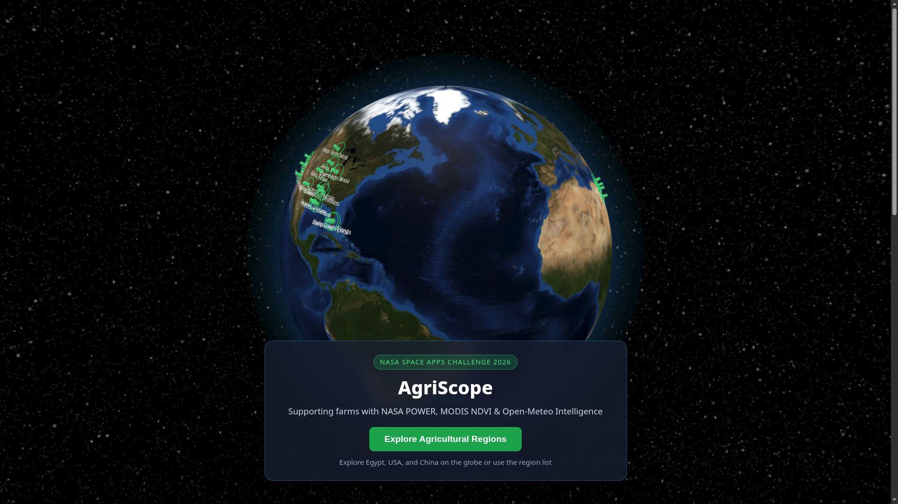
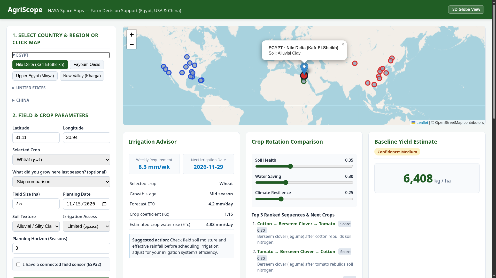
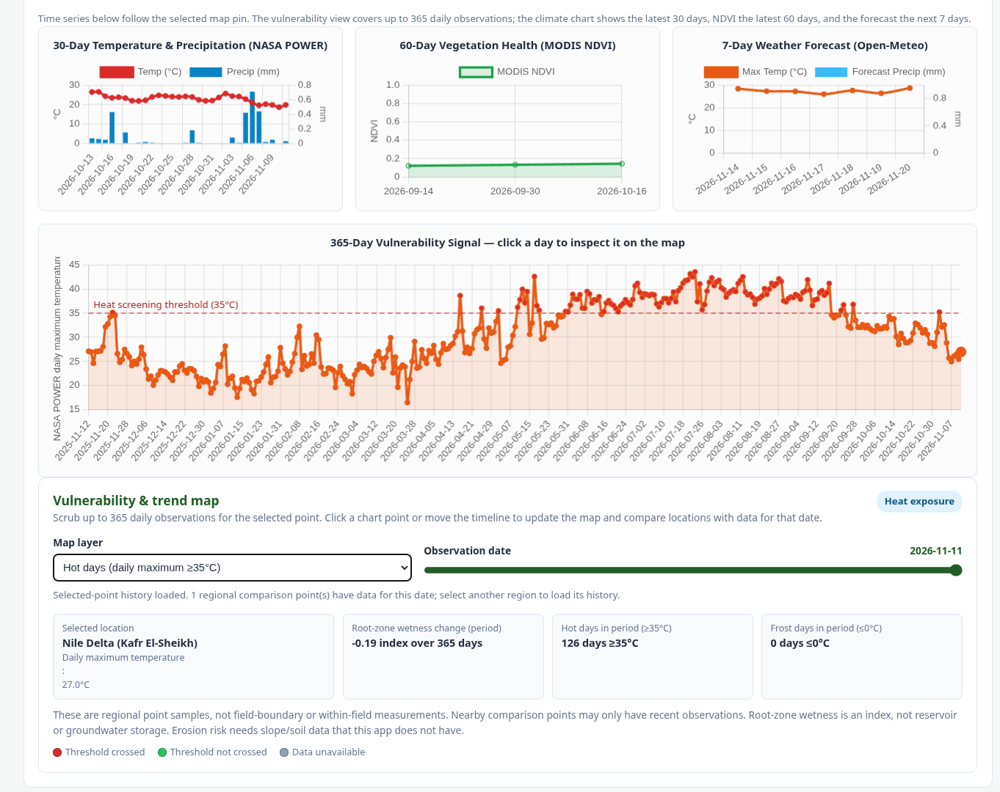
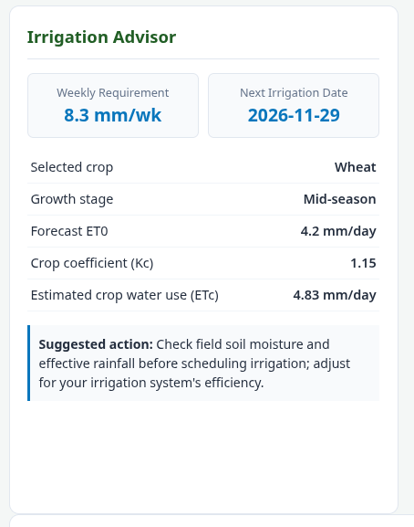
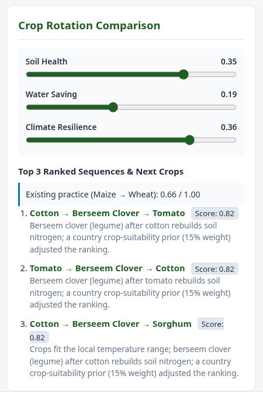

# AgriScope

### From Earth observations to climate-resilient agricultural decisions.

## Live Demo

**[Explore AgriScope](https://63.183.126.138.nip.io/)**

Try the deployed application and explore its climate-risk maps, irrigation recommendations, and crop-rotation planning.

## Project Demonstration

[](https://drive.google.com/file/d/1r-ZWgFY3-dbDP6Z7n2IBrJ7dHGS5z9Fu/view)

**AgriScope** is a climate-aware agricultural decision-support platform that helps farmers and agronomists understand environmental stress, estimate irrigation requirements, and compare crop-rotation strategies.

By combining NASA Earth data, weather forecasts, crop characteristics, soil information, and agronomic rules, AgriScope turns environmental observations into practical insights for agricultural planning.

Built for the **NASA Space Apps Challenge 2026 — Field Shift: Adapting Farms with NASA Data**.

<!-- Add docs/images/dashboard-overview.png before publishing this image reference. -->


---

## The problem: Agriculture is facing a changing climate

Agriculture depends on environmental conditions that are becoming increasingly difficult to predict.

Rising temperatures, irregular rainfall, water scarcity, soil degradation, and changing pest and disease pressures affect not only the current growing season, but also the long-term sustainability of agricultural land.

These pressures are connected. Higher temperatures increase crop water demand. Unreliable rainfall makes irrigation planning more difficult. Repeated cultivation without appropriate rotation can worsen soil and disease-related problems. Decisions made for one season can affect the productivity of future seasons.

Farmers need more than isolated weather information. They need a way to understand environmental conditions and evaluate how today's agricultural decisions may affect tomorrow's farm.

## Why Egypt?

Egypt provides a particularly important example of these challenges.

Agricultural production is concentrated along the Nile Valley and Delta, while the country faces significant constraints on freshwater availability. Rising temperatures increase evaporation and crop water requirements, while parts of the Nile Delta face additional pressure from soil salinity, seawater intrusion, and land degradation.

These challenges make agricultural planning especially important:

- **Heat stress:** Higher temperatures can affect crop development, productivity, and water requirements.
- **Water scarcity:** Agriculture depends heavily on irrigation, making efficient water allocation essential.
- **Soil degradation and salinity:** Declining soil quality threatens the long-term productivity of agricultural land.
- **Changing pest and disease pressures:** Shifting environmental conditions and repeated cultivation can increase agricultural risks.

AgriScope begins with agricultural regions in Egypt, including the Nile Delta, Fayoum, Upper Egypt, and the New Valley. The platform also includes reference locations in the United States and China, with confidence information that reflects the available model coverage.

The goal is to build a decision-support approach that can be extended to additional agricultural regions as suitable local data becomes available.

---

## How AgriScope addresses these challenges

AgriScope connects environmental observations to agricultural planning through four complementary capabilities.

### 1. Understand environmental vulnerability

The **Vulnerability and Trend Map** combines historical environmental data with interactive geographic visualization.

Users can inspect:

- Daily temperature history and heat exposure.
- Root-zone wetness and low-wetness screening signals.
- Frost exposure.
- Changes in environmental conditions over time.
- Regional reference locations where historical data is available.

The map includes a timeline that allows users to inspect individual dates and compare available regional observations.



This helps users identify environmental stress signals and understand the conditions surrounding their agricultural decisions.

### 2. Plan irrigation around water demand

The **Irrigation Advisor** estimates crop water requirements using weather forecasts and crop-specific water coefficients.

It considers:

- Reference evapotranspiration (ET₀).
- Crop coefficients (Kc) and estimated crop evapotranspiration (ETc).
- Forecast precipitation.
- Soil texture and root-zone wetness inputs.
- Irrigation availability and assumed irrigation efficiency.

The system estimates weekly irrigation requirements and provides a suggested next irrigation date.

Rather than treating rainfall as guaranteed water supply, the advisor incorporates forecast precipitation into its water-requirement estimate.

<!-- Add docs/images/irrigation-advisor.png before publishing. -->


### 3. Compare sustainable crop-rotation strategies

The **Crop Rotation Engine** is central to AgriScope.

Instead of recommending crops based on a single environmental variable, it evaluates sequences across multiple growing seasons.

Rotation strategies are ranked using four criteria:

| Criterion | What it evaluates |
|---|---|
| Soil health | Crop-to-crop transition rules, including nitrogen-fixing crops and reduced soil conflicts. |
| Water demand | Relative crop water requirements and irrigation availability. |
| Climate suitability | Compatibility between crop temperature requirements and local conditions. |
| Rotation diversity | Diversity of crop families across the proposed sequence. |

Users can adjust the importance of these criteria to reflect their priorities.

The engine also considers crop calendars, seasonal suitability, restrictions on repeating crops, and crop-family transitions.

Diversifying crop families can help break some pest and disease cycles, while legumes such as faba bean and berseem clover can contribute to soil nitrogen management.

The system ranks the strongest candidate sequences and provides explanations for their scores.

<!-- Add docs/images/crop-rotation.png before publishing. -->


### 4. Estimate yield with confidence information

AgriScope provides a baseline yield estimate using available regional models and agricultural reference data.

The estimation approach depends on geographic coverage:

- **Egypt:** A trained Random Forest yield model uses environmental and farm-related features, with confidence influenced by proximity to reference training locations.
- **United States and China:** Estimates use country-level yield benchmarks, field-specific weather-response model.
- **Other locations:** A low-confidence heuristic estimate may be available when the required crop reference data exists.

Every estimate includes a confidence level and explanatory notes. These outputs are intended for comparison and planning, not as guaranteed predictions of actual harvests.

---

## Data sources

AgriScope combines environmental data from multiple services.

| Source | Data used | Role in AgriScope |
|---|---|---|
| [NASA POWER](https://power.larc.nasa.gov/) | Temperature, precipitation, solar radiation, root-zone and surface wetness variables | Historical climate and environmental context |
| [MODIS MOD13Q1](https://modis.ornl.gov/) | NDVI vegetation index | Vegetation-condition indicators and recent trends |
| [Open-Meteo](https://open-meteo.com/) | Seven-day weather forecast and FAO reference evapotranspiration | Short-term weather and irrigation planning |
| [FAOSTAT](https://faostatservices.fao.org/api/) | UN Food and Agriculture Organization for programmatic access to its food and agriculture statistics database, covering 180+ countries from 1961 to present | Data use to train ML model |

The application uses caching and fallback behavior to remain usable when external data services are unavailable.

Historical observations, short-term forecasts, model estimates, and fallback values are treated as different types of information and should not be interpreted as interchangeable measurements.

---

## How it works

AgriScope follows a data-to-decision workflow:

1. **Select a region:** Choose an agricultural reference region or provide geographic coordinates.
2. **Describe the field:** Specify crop, previous crop, soil texture, field size, planting date, and irrigation availability.
3. **Collect environmental information:** Retrieve historical NASA POWER data, MODIS vegetation indicators, and Open-Meteo forecasts.
4. **Evaluate the field:** Calculate irrigation requirements, environmental indicators, and yield estimates.
5. **Compare rotation strategies:** Evaluate candidate crop sequences using agronomic rules and configurable priorities.
6. **Inspect recommendations:** Review ranked options, explanations, confidence levels, and data-source limitations.

The system is designed to make the reasoning behind its recommendations visible rather than presenting unexplained outputs.

---

## Technology stack

**Backend**
- Python 3.11+
- FastAPI
- Pydantic
- NumPy and Pandas
- scikit-learn
- XGBoost
- SQLite

**Frontend**
- HTML, CSS, and JavaScript
- Leaflet for interactive maps
- Chart.js for data visualization
- Globe.gl for the 3D globe interface

**Data and models**
- NASA POWER API
- MODIS MOD13Q1
- Open-Meteo API
- FAO-based crop-water calculations
- Crop characteristics and rotation reference datasets
- Trained machine-learning model artifacts

---

## Optional field-sensor integration

AgriScope includes an optional ESP32 telemetry integration.

<details>
<summary><strong>Hardware Components</strong></summary>

| Component | Purpose |
|---|---|
| ESP32 DevKit V1 | Microcontroller and Wi-Fi connectivity |
| Capacitive Soil Moisture Sensor v1.2 | Measures soil moisture |
| BME280 | Measures temperature, humidity, and pressure |
| SSD1306 OLED Display | Displays sensor readings |
| Relay Module | Controls the irrigation pump |
| Water Pump | Provides irrigation |

</details>

The backend can receive field measurements such as soil moisture, temperature, and humidity through its telemetry API. These measurements can complement the environmental information retrieved from remote sources.

A simulator is included for demonstrations without physical hardware:

```bash
cd backend
python simulate_device.py
```

The integration supports:
- Soil-moisture telemetry.
- Sensor status and freshness checks.
- Comparison between regional environmental data and field measurements.
- Device command polling for irrigation demonstrations.

The sensor feature is optional and disabled by default. Simulated readings are identified separately from real device readings.

---

## Project structure

```text
agriscope/
├── README.md
├── pyproject.toml
├── uv.lock
├── backend/
│   ├── Dockerfile
│   ├── requirements.txt
│   ├── simulate_device.py
│   ├── prewarm_cache.py
│   ├── kc_table.json
│   ├── app/
│   │   ├── main.py
│   │   ├── api/
│   │   │   ├── recommendation.py
│   │   │   ├── regions.py
│   │   │   ├── telemetry.py
│   │   │   └── trends.py
│   │   ├── engine/
│   │   │   ├── irrigation.py
│   │   │   ├── rotation.py
│   │   │   ├── yield_estimation.py
│   │   │   ├── climatology.py
│   │   │   ├── country_models.py
│   │   │   ├── models/
│   │   │   └── data/
│   │   ├── schemas/
│   │   └── services/
│   └── tests/
├── data/
│   ├── kc_table.json
│   └── processed/
│       └── reference/
│           ├── crop_calendars.csv
│           ├── crop_characteristics.csv
│           ├── regions.json
│           └── rotation_rules.csv
docs/
├── crop-rotation.png
├── dashboard-overview.png
├── demo-thumbnail.png
├── irrigation-advisor.png
└── vulnerability-map.png
|
└── frontend/
    ├── index.html
    ├── css/
    │   └── style.css
    └── js/
        ├── api.js
        ├── dashboard.js
        ├── globe.js
        └── map.js
```

---

## Getting started

### Requirements

- Python 3.11 or newer
- pip
- A modern web browser

### 1. Clone the repository

```bash
git clone https://github.com/Wael-06/agriscope.git
cd agriscope
```

### 2. Start the backend

```bash
cd backend

python -m venv .venv
source .venv/bin/activate

pip install -r requirements.txt

uvicorn app.main:app --reload --host 0.0.0.0 --port 8000
```

The API documentation is available at:

- http://127.0.0.1:8000/docs
- http://127.0.0.1:8000/redoc

### 3. Start the frontend

Open another terminal:

```bash
cd agriscope/frontend
python -m http.server 8080
```

Open:

```text
http://127.0.0.1:8080
```

The frontend checks backend availability and can fall back to local demonstration content when the API is unavailable.

### 4. Run the backend with Docker

```bash
cd backend

docker build -t agriscope-backend .

docker run -p 8080:8080 agriscope-backend
```

---

## API overview

| Method | Endpoint | Description |
|---|---|---|
| GET | `/health` | Backend health check |
| GET | `/regions` | Available regional presets |
| GET | `/trends` | Historical climate, NDVI, and forecast data |
| POST | `/recommendation` | Irrigation, rotation, and yield analysis |
| POST | `/api/telemetry` | Receive field-sensor readings |
| GET | `/api/telemetry/{device_id}/status` | Retrieve sensor status |
| GET | `/api/device/command` | Retrieve pending device commands |
| POST | `/api/device/command` | Submit a device command |

### Example recommendation request

```json
{
  "lat": 31.11,
  "lon": 30.94,
  "crop": "wheat",
  "previous_crop": "cotton",
  "field_size_ha": 2.5,
  "planting_date": "2026-11-15",
  "soil_texture": "clay",
  "irrigation_availability": "limited",
  "planning_horizon_seasons": 3,
  "use_live_sensor": false
}
```

The recommendation endpoint returns:
- Estimated weekly irrigation requirement.
- Suggested next irrigation date.
- Ranked crop-rotation sequences and explanations.
- Baseline rotation score when a previous crop is supplied.
- Baseline yield estimate and confidence level.
- Data-source fallback information and explanatory notes.

---

## Scientific limitations

AgriScope is a research and prototype decision-support application. It is not a certified agronomic system and should not replace field measurements or professional agricultural advice.

Important limitations include:

- Environmental data is sampled at geographic points and is not validated against individual field boundaries.
- NASA POWER root-zone wetness is a regional environmental indicator, not a direct measurement of groundwater or reservoir storage.
- MODIS NDVI is a vegetation-condition indicator; it does not independently establish crop yield or diagnose a specific disease.
- Soil texture and rotation reference rules do not replace laboratory measurements of salinity, pH, nutrients, or organic matter.
- Crop-family diversity is used as a rotation-diversity consideration; the system does not predict specific pest or disease outbreaks.
- Irrigation calculations use simplified assumptions and should be checked against actual field conditions and irrigation-system characteristics.
- Yield estimates have different levels of reliability depending on regional model coverage and available reference data.
- Historical vulnerability signals and short-term weather forecasts are not long-term climate projections.

AgriScope presents estimates and recommendations with explanatory context so that users can understand the assumptions and uncertainty behind them.

---

## Future direction

The platform is designed to evolve toward more comprehensive climate-resilient agricultural planning.

Potential extensions include:

- Integrating field-level soil salinity, pH, and nutrient information.
- Improving soil-health evaluation beyond crop-transition reference scores.
- Expanding validated crop and regional model coverage.
- Incorporating more detailed crop calendars and locally reviewed agronomic rules.
- Adding more detailed water-budget and irrigation scenarios.
- Integrating additional NASA Earth-observation products.
- Improving the assessment of climate-related pest and disease risks.
- Supporting more agricultural regions and local farming practices.

---

## Acknowledgements

AgriScope was developed for the **NASA Space Apps Challenge 2026**, responding to the challenge **Field Shift: Adapting Farms with NASA Data**.

We acknowledge the providers of the open environmental and agricultural data used by the platform, including NASA POWER, NASA MODIS, Open-Meteo, and the agricultural reference sources documented in the project.

AgriScope is an independent project and is not an official NASA product or an endorsement by NASA.

---

**AgriScope - Turning environmental data into better-informed agricultural decisions.**
